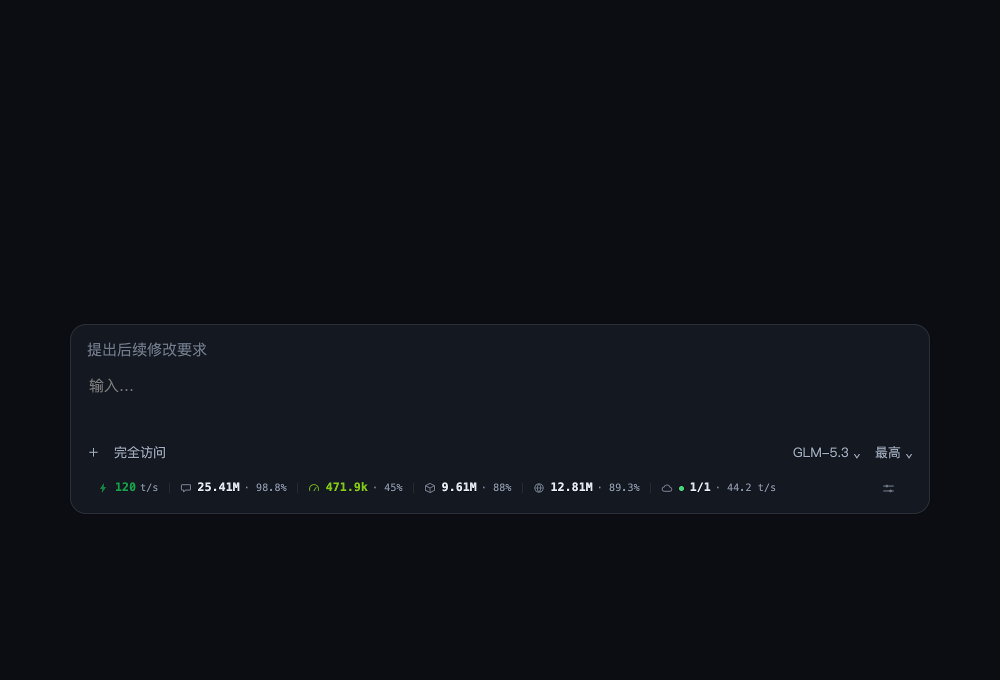
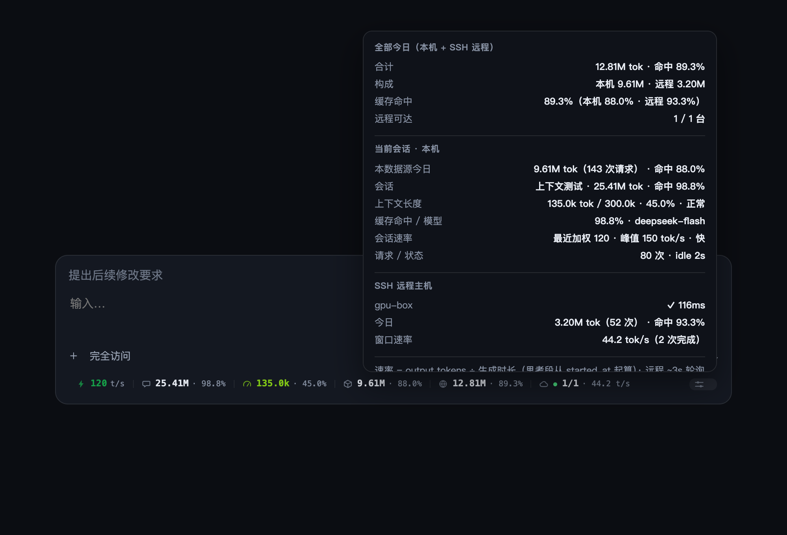
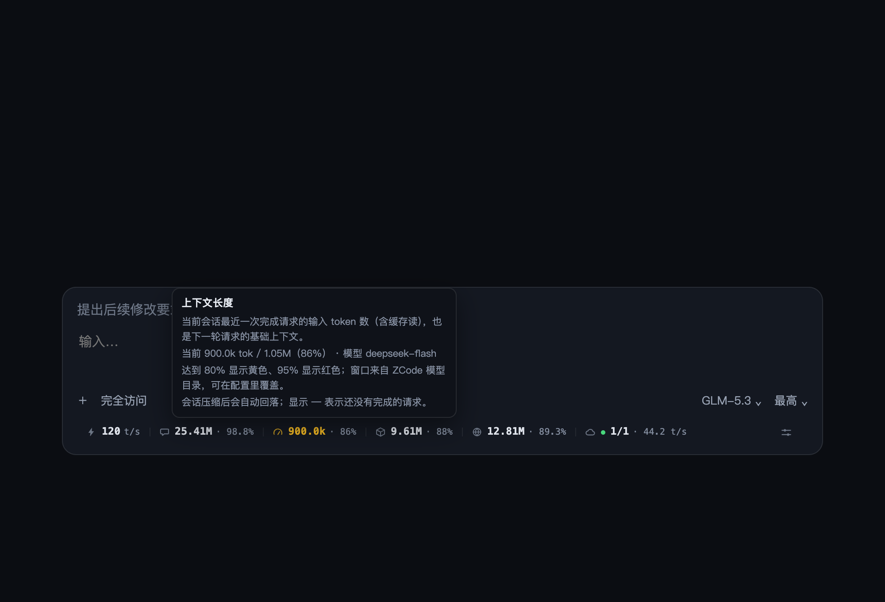
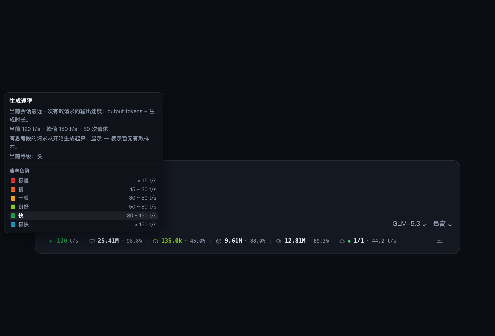

# Tokmon

**ZCode Token Monitor** — 本地 + SSH 远程的 token 用量与生成速率监控插件。

> **English** — Tokmon is a ZCode plugin that monitors token usage and generation throughput on your machine and across SSH remote hosts. Core features (MCP tool, slash commands, terminal dashboard) never modify client files; the floating status bar is opt-in and can be removed byte-for-byte.

[](https://github.com/EV12138/zcode-tokmon/actions/workflows/tests.yml)
[](LICENSE)
[](https://www.python.org/)



Tokmon（**Tok**en **Mon**itor）把 ZCode 的 token 消耗和生成速度变成随时可见、可查询、可跨机汇总的数据：本地会话、SSH 远程主机、子代理、今日合计，一条状态条 + 一个 MCP 工具 + 终端面板就能全部掌握。

## 为什么是 Tokmon

- **核心零侵入**：MCP 工具、`/usage` 命令、`/usage-watch` 终端面板都不修改 ZCode 客户端文件。
- **SSH 远程是一等公民**：不是"附加查询"，而是和本地同一条数据管线——按会话 id 精确分流，本地库查不到就交给远端主机。
- **远端自动部署**：首次查询自动把轻量 agent 推到远端 `~/.zcode/token-monitor/agent.py`，SHA256 校验、版本不符自动更新，不需要手工传脚本。
- **SSH 连接复用**：ControlMaster + ControlPersist，轮询不再每次全新握手；`config.json` / ZCode `setting.json` 变化自动热重载目标，新连的远程工作区无需重启数据泵。
- **口径可验证**：速率、上下文、今日汇总都有独立 SQL 交叉校验和单元测试，不靠"看起来差不多"。
- **可选悬浮条**：想要输入框下方的实时监控栏再显式安装；卸载后 `app.asar` 与官方版本逐字节一致（sha256 往返验证）。

## 功能

- **实时速率**：⚡ tok/s，按当前会话精确取值；生成中脉冲提示；缓存命中率直接反映输入复用情况。
- **会话累计**：💬 当前会话累计 token（不含子代理，子代理是独立会话）。
- **上下文长度**：⏱ 最近一次完成请求的输入 token（含缓存读），即下一轮的基础上下文；窗口取自 **ZCode 模型设置里该模型自己的上下文长度**（模型规则优先、provider 模型目录兜底，按 provider + model 精确匹配），显示 `已用 / 配置窗口 · 实际百分比`；数字和颜色都按实际占用率计算，按 5 档预警。**在当前聊天窗口切换模型后立即按新模型的窗口重算**，不用等下一条请求或新建会话。
- **模型 / 请求明细**：`/usage models` 按模型聚合请求数、输入/输出/缓存、缓存命中率、平均 TTFT；`/usage recent` 看最近 N 次请求的速率、TTFT、重试、工具调用。
- **分源今日**：📦 当前会话所在数据源的今日总量（本地或远端主机）。
- **全部今日**：🌐 本机 + 所有可达 SSH 远程主机的今日合计，远程失败时标黄并提示。
- **远程健康**：☁ 成功/总主机数 + 远端窗口速率；明细面板可看每台主机的延迟、今日、会话速率。
- **明细面板**：⚙ 固定在齿轮旁，当前会话、上下文、速率、请求/状态、各远程主机详情。
- **悬停说明**：每个数字都有自绘说明卡片；速率与上下文色阶用「色块 + 等级 + 范围」图例呈现，当前档位高亮。**流式输出自动滚动时提示保持显示**，并跟随数据条位置更新。所有百分比统一保留一位小数（如 `45.0%`、`88.0%`）。
- **三种形态**：悬浮状态条、MCP 工具、终端实时面板。

| 明细面板 | 悬停说明（上下文色阶） |
| --- | --- |
|  |  |

速率提示的色阶图例：



## 安装

### 从 GitHub 安装（推荐）

1. ZCode → 设置 → 插件 → 添加插件市场 → 填入本仓库地址：
   `https://github.com/EV12138/zcode-tokmon`
2. 在市场中安装 **Tokmon**（插件包名：`zcode-token-monitor`）。
3. 重开会话，MCP 工具 `token_monitor` 与 `/usage` 命令即可使用。

> 插件包名保留 `zcode-token-monitor`，以兼容已经安装过的用户；市场与项目名称是 Tokmon。

### 本地开发安装

```bash
git clone https://github.com/EV12138/zcode-tokmon.git
cd zcode-tokmon
# ZCode → 设置 → 插件 → 添加插件市场 → 选择本目录
```

要求：本机与远程机都有 `python3`（≥3.9）；远程机 SSH 免密可用（`BatchMode=yes`）。

### 远程主机要求

- `python3` 可用（远端 agent 零依赖，只用标准库）。
- 已配置 SSH 密钥免密登录：`ssh user@host 'echo ok'` 直接成功。
- 首次查询会自动部署/更新 `~/.zcode/token-monitor/agent.py`，不需要手工操作。

## 使用

### 悬浮状态条（可选）

输入框下方的实时监控栏，包含上面提到的全部数据。安装/卸载是显式命令，不会自动注入：

```bash
python3 <插件目录>/patch_asar.py install   # 注入 + 安装 macOS 自修复代理，随后完全退出并重开 ZCode
python3 <插件目录>/patch_asar.py install --no-auto-repair  # 只注入，不装代理
python3 <插件目录>/patch_asar.py check     # 检查注入与运行时一致性
python3 <插件目录>/patch_asar.py remove    # 剥离注入并卸载自修复代理
```

也可以在会话里用 `/usage-bar install|remove|check`。

说明：

- 只改 `app.asar` 入口尾部一行 `[tokmon]` 标记的 dynamic import，不备份、不覆盖其它工具注入。
- **ZCode 更新覆盖 `app.asar` 后，自修复代理会自动重新注入**（macOS）：代理监听 `app.asar`，60 秒内重新注入；如果更新后的 ZCode 已经先启动，且刚启动 5 分钟内、没有正在生成的请求，会自动重启一次让注入生效。
- 代理连续 3 次/10 分钟仍无法稳定时会熔断并通知，避免更新回滚造成无限重启。
- 运行时文件在 `~/.zcode/token-monitor/`，日志在 `inject.log`；自修复日志在 `auto-repair.log`。
- 不想用代理可以在 install 时加 `--no-auto-repair`，或之后跑 `patch_asar.py remove` 卸载；临时停用可把 config 的 `auto_repair` 设为 `false`。

### 命令

| 命令 | 作用 |
| --- | --- |
| `/usage` | 当前会话 + 今日 + 速率 |
| `/usage today` / `week` / `days:N` | 今日 / 近 7 天 / 近 N 天 |
| `/usage sessions` | 活跃会话列表 |
| `/usage models[:days]` | 按模型聚合（默认 7 天）：请求、输入/输出/缓存、命中率、平均 TTFT |
| `/usage recent[:N]` | 最近 N 次完成请求明细（默认 10）：速率、TTFT、重试、工具调用 |
| `/usage remote` | 所有 SSH 远程主机的用量与速率 |
| `/usage all` | 本地 + 远程汇总 |
| `/usage-watch` | 终端实时面板（会话内跑 10 秒快照） |
| `/usage-bar install\|remove\|check` | 管理悬浮状态条 |

### MCP 工具

插件注册 MCP 工具 `token_monitor(scope)`：

```json
{ "scope": "now" }          // current | now
{ "scope": "today" }
{ "scope": "week" }
{ "scope": "days:30" }
{ "scope": "sessions" }
{ "scope": "models:7" }     // 按模型聚合
{ "scope": "recent:10" }    // 最近请求明细
{ "scope": "remote" }
{ "scope": "all" }
```

`remote` / `all` 会通过 SSH 查询所有目标；首次查询会自动部署远端 agent（约数秒）。

### 终端面板

```bash
D=~/.zcode/cli/plugins/cache/<marketplace>/zcode-token-monitor/<version>
python3 "$D/monitor.py"            # 常驻面板，Ctrl+C 退出
python3 "$D/monitor.py" --once     # 单帧
python3 "$D/monitor.py" --interval 1 --no-remote
python3 "$D/cli.py" remote         # 远程报表
```

## 配置

首次运行自动生成 `~/.zcode/token-monitor/config.json`：

```json
{
  "python_path": "",
  "context_windows": {
    "glm-5.3": 1000000
  },
  "context_window_default": 0,
  "remote": {
    "auto_discover": true,
    "targets": [
      { "label": "gpu-box", "host": "gpu.example.com", "username": "alice", "port": 22 },
      { "label": "bastion", "ssh": ["ssh", "-J", "jump@bastion", "alice@10.0.0.5"] }
    ],
    "poll_s": 2,
    "timeout_s": 6,
    "control_persist_s": 300,
    "bootstrap": true,
    "neg_cache_s": 60
  }
}
```

- `auto_discover: true` 会读取 ZCode 的 `~/.zcode/v2/setting.json`，自动发现连过的 SSH 远程工作区（跳过密码型连接）。
- `targets` 手动目标优先于自动发现；支持跳板机等自定义 `ssh` argv。
- `python_path` 可指定数据泵使用的 Python 绝对路径（Electron 主进程 PATH 较瘦时有用）。
- `context_windows` 可覆盖模型上下文窗口（按模型 id 子串匹配，优先级高于 ZCode 模型配置）；`context_window_default` 是模型配置里找不到时使用的默认窗口（0 = 不回退）。
- `auto_repair`（默认 `true`，macOS）控制自修复代理；设为 `false` 后代理只检查、不再重新注入。

完整示例见 [`config.example.json`](config.example.json)。

## 数据口径

- **速率** = `output_tokens ÷ 生成时长`；有思考段（`reasoning_tokens>0`）或 Claude 系模型从 `started_at` 起算，否则从 `first_token_at` 起算；窗口守卫 200ms～1h；最近 5 条有效样本加权。
- **上下文长度** = 最近一次完成请求的 `input_tokens`（含缓存读），即下一轮的基础上下文；窗口优先读取 ZCode 模型设置中该模型自己的上下文长度（`provider_config.json` 模型规则，回退到 `config.json` 的 `limit.context`），按 provider + model 精确匹配；本地和 SSH 远端各自使用本机的模型配置。
- **上下文占用率**的数字和颜色都按实际占用率计算，不再有起算点偏移。
- **缓存命中率** = `cache_read / input`；输入本身已含缓存读，所以命中率高通常意味着更低的延迟和成本。
- **颜色分级**：速率 `<15` 深红、`15~30` 橙红、`30~50` 琥珀、`50~80` 黄绿、`80~150` 翠绿、`>150` 青色；上下文占用 `<30%` 绿、`30~50%` 黄绿、`50~70%` 琥珀、`70~85%` 橙红、`≥85%` 深红。
- **今日 / 区间汇总** 只统计 `status='completed'`，排除 error/running/cancelled。
- **总 token** = `input + output`（input 已含 cache read，不重复相加）。
- **会话累计**只算主会话自身；子代理是独立会话，计入今日总量但不计入主会话累计。
- **全部今日** = 本机今日 + 所有可达 SSH 远程主机今日；远程失败的主机不计入并标黄提示。
- **窗口速率** = 上次轮询之后完成请求的聚合速率；总量用 SQL 聚合，速率采样上限 500 条并标记 `sampleTruncated`。

## 架构

```
ZCode 本地 db.sqlite（只读）
        │
        ▼
   agent.py serve  ── 行协议 / 后台远程刷新 ──► inject-main.cjs ──► overlay.js（悬浮条）
        │
        ├── remote.py ── SSH ControlMaster ──► 远端 ~/.zcode/token-monitor/agent.py
        │                                        └─ 远端 db.sqlite（只读）
        │
        ├── usage_mcp.py ── MCP 工具 token_monitor(scope)
        ├── cli.py ── /usage 兜底 / 终端报表
        └── monitor.py ── /usage-watch 实时面板
```

- **agent.py** 单文件同时是本地查询库和远端 agent（零依赖）。
- **remote.py** 负责目标发现、SSH 复用、自动部署、并行查询。
- **inject-main.cjs** 只在悬浮条安装后由 `app.asar` 入口加载；数据泵常驻、后台刷新远程，不阻塞 UI。
- **overlay.js** 渲染进程注入，只更新数值不重建 DOM，避免布局抖动。

## 安全与隐私

- 所有数据库访问都是 `mode=ro` 只读，不会写入 ZCode 数据。
- 用量数据只在本机与你自己配置的 SSH 主机之间流动，不上传任何第三方服务。
- SSH 强制 `BatchMode=yes`，不强解密/复用宿主保存的密码或加密私钥；密码型连接会被跳过或失败提示。
- 远端 agent 是纯标准库脚本，部署前做 SHA256 校验。
- 悬浮条是显式 opt-in；`remove` 后 `app.asar` 与官方版本逐字节一致（sha256 往返验证）。
- 不收集遥测、不联网上报。

## 测试

```bash
python3 tests/test_rate.py      # 速率口径 15 项
python3 tests/test_data.py      # 数据层 7 项：今日/上下文/速率/delta/截断防护
python3 tests/verify_real.py    # 对真实库交叉验证：agent 输出 vs 独立 SQL
```

`verify_real.py` 也可以在远端执行：

```bash
TOKMON_AGENT_DIR=~/.zcode/token-monitor python3 verify_real.py
```


## 开发

```bash
# 语法检查
python3 -m py_compile plugins/zcode-token-monitor/*.py
node --check plugins/zcode-token-monitor/overlay.js
node --check plugins/zcode-token-monitor/inject-main.cjs

# 测试
python3 tests/test_rate.py && python3 tests/test_data.py
python3 tests/test_config.py && python3 tests/test_model_context.py
```

提交流程：fork → 开分支 → 改代码 + 补测试 → PR。欢迎 issue 反馈数据口径、兼容性或新主机场景。

## 故障排查

- **远端数据时有时无**：看 `~/.zcode/token-monitor/inject.log` 是否反复出现 `serve exited`。1.0.0 起 SSH 子进程不再继承数据泵 stdin，正常情况下应只有一次 `serve started`。
- **远端查询失败**：先跑 `ssh user@host 'echo ok'`，确认免密；失败目标有 60s 负缓存，等一会或重跑即重试。
- **远端无速率/会话**：远端近 30 分钟没有 ZCode 请求时属正常。
- **状态条不出现**：跑 `patch_asar.py check`，确认「已注入」且运行时一致；完全退出并重开 ZCode。macOS 可跑 `~/.zcode/token-monitor/auto_repair.py status` 看自修复代理是否在运行。
- **ZCode 更新后状态条消失**：正常情况下自修复代理会自动处理；若没有恢复，看 `auto-repair.log`，或重跑 `patch_asar.py install`。
- **库结构漂移**：ZCode 升级若改了 `model_usage` 表结构，工具会返回明确错误，更新插件即可。

## 版本历史

- **1.1.13** — macOS 自修复代理：ZCode 更新覆盖 `app.asar` 后自动重新注入，必要时自动重启一次；`install` 默认安装，`remove` 自动卸载。
- **1.1.12** — 数据条、悬停提示与明细面板里的所有百分比统一保留一位小数。
- **1.1.11** — 流式输出滚动时悬停提示保持显示并跟随数据条；移出后重新移入同一项也能再次弹出。
- **1.1.10** — 当前聊天窗口切换模型后立即按新模型窗口重算上下文百分比，不必等下一条请求或新会话。
- **1.1.9** — 上下文窗口改为按所选模型的 ZCode 模型配置（provider + model）计算，不再固定 1M；本地与 SSH 远端各读本机配置。
- **1.1.8** — 上下文颜色改按实际占用率分级，取消 25% 起算；45% 现在显示黄绿，不再是绿色。
- **1.1.7** — 速率与上下文提示改为色块图例：每档显示颜色块、等级与范围，当前档位高亮；移除文字色名说明。
- **1.1.6** — 上下文数字改为显示实际占用率；25% 起算仅用于颜色分级。
- **1.1.5** — 上下文补齐 30~50% 黄绿档位：<30% 绿、30~50% 黄绿、50~70% 琥珀、70~85% 橙红、≥85% 深红。
- **1.1.4** — 上下文颜色门槛下调：≥50% 即琥珀、≥70% 橙红、≥85% 深红。
- **1.1.3** — 上下文占用率默认从 25% 起算（前 25% 不计入），显示值与颜色分级同步按起算后的比例。
- **1.1.2** — 速率按 6 档色阶显示（深红→青色），上下文占用按 5 档色阶显示（绿→深红）。
- **1.1.1** — 会话累计、分源今日、全部今日后直接显示缓存命中率；明细面板给出本机/远程拆分。
- **1.1.0** — 模型/请求明细（`/usage models`、`/usage recent`）、缓存命中率、上下文窗口百分比与 80%/95% 预警、远程目标热重载（新 SSH 工作区免重启）。
- **1.0.0** — 首个开源版本：本地 + SSH 远程监控、MCP/命令/终端/悬浮条、上下文长度、全部今日汇总、数据口径交叉验证。
- 0.3.x — 数据层审计、后台远程刷新、SSH stdin 隔离、数据泵重启竞态修复。
- 0.2.x — SSH 会话按 id 精确分流、上下文长度、UI 重构、悬停说明。
- 0.1.x — 初版查询核心、MCP、终端面板、自动部署。

## 致谢

- 数据口径与「输入含 cache read」「思考段从 started_at 起算」等经验来自对 [ByteRax/zcode-token-usage-statusbar](https://github.com/ByteRax/zcode-token-usage-statusbar) 的研究；Tokmon 是独立实现，核心查询与远程链路重写，且默认不修改客户端文件。
- ZCode 插件生态与数据库 schema 由 ZCode 提供。

## License

[MIT](LICENSE)
